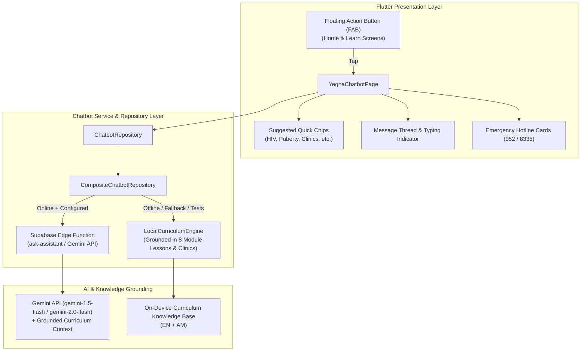

# Yegna Health Conversational AI Chatbot Master Plans

This directory contains the complete modular architectural and implementation plans for the Yegna Health AI Assistant:

- **[01. Foundation Plan](chatbot/01_CHATBOT_FOUNDATION_PLAN.md)**: Conversational AI Health Assistant, Gemini API edge function, offline curriculum knowledge engine, and FAB integration.
- **[02. Domain Guardrails Plan](chatbot/02_CHATBOT_DOMAIN_GUARDRAILS_PLAN.md)**: Strict medical/health domain boundaries, negative refusal directives, and redirection away from non-health topics (physics, math, coding, politics).
- **[03. Response Design Plan](chatbot/03_CHATBOT_RESPONSE_DESIGN_PLAN.md)**: Structured ChatGPT / Gemini-style response formatting, custom teal bullet dots, numbered badges, vertical accent headers, and asterisk elimination.
- **[04. Multi-Session Chat History Plan](chatbot/04_CHATBOT_HISTORY_PLAN.md)**: ChatGPT-style multi-session chat history, slide-out drawer, `+ New Chat` workflow, relative date grouping, and local offline persistence.

---

## Goal Description
Integrate an empathetic, youth-friendly, confidential conversational chatbot ("Yegna Health Assistant") into the app. The chatbot answers questions regarding reproductive health, the 8 module curricula (HIV/AIDS, STIs, Puberty, SRH & Contraception, Hepatitis, GBV, Substance Abuse, Mental Health), and local youth clinic discovery in Addis Ababa and beyond. It supports both **English and Amharic**, provides one-tap suggested prompt chips, and enforces medical safety guardrails with immediate national helpline triggers (952 / 8335).

Per user requirements:
1. **Entry Point**: A floating action button (FAB) on the bottom right of the **Home** and **Learn** screens.
2. **AI Provider**: Powered by Google's **Gemini API** via Supabase Edge Functions with system-prompt curriculum grounding, paired with an intelligent **on-device offline curriculum engine** for seamless offline and low-bandwidth availability in Ethiopia.

---

## Confidentiality & Medical Safety Guarantees
- The chatbot is an **educational health assistant**, not a clinical diagnostician. Every session displays an educational disclaimer.
- **Crisis & Emergency Detection**: If a user inputs messages related to acute trauma, domestic violence/assault, or severe distress, the assistant immediately displays prominent, one-tap calling buttons for the **952 Health Emergency** and **8335 Youth Helpline**.
- **100% Confidential**: Chat history is kept in transient session state in memory and is **never** uploaded to public user profiles or logged with personally identifiable markers.

---

## Technical Architecture

---

## Implementation Steps

1. **Bilingual Localization (`lib/l10n/`)**:
   - Add localization strings in `app_en.arb` and `app_am.arb`.
   - Regenerate localizations with `flutter gen-l10n`.

2. **Chatbot Models & Repositories (`lib/src/chatbot/`)**:
   - `ChatMessage` data model with emergency flags and action shortcuts.
   - `ChatbotRepository` interface.
   - `LocalCurriculumChatbotRepository` containing grounded educational knowledge across all 8 modules and Addis Ababa clinics, with crisis detection and full English/Amharic support.
   - `SupabaseGeminiChatbotRepository` to invoke the `ask-assistant` Edge Function.
   - `CompositeChatbotRepository` to seamlessly fall back to local knowledge when offline or unconfigured.

3. **Supabase Edge Function (`supabase/functions/ask-assistant/`)**:
   - Deno Edge Function with CORS, Auth verification, and Google Gemini API integration with system prompt grounding.

4. **UI Components (`lib/src/chatbot/` & `lib/src/app.dart`)**:
   - `YegnaChatbotFab`: Floating action button with modern gradient styling and responsive tap animation.
   - `YegnaChatbotPage`: Full-screen conversational view with message bubbles, typing indicators, suggested chips, safety disclaimer, and emergency helpline cards.
   - Wire FAB into `AppShell` scaffold for Home (`_selectedIndex == 0`) and Learn (`_selectedIndex == 3`).

5. **Verification & Quality Checks**:
   - Comprehensive unit and widget tests.
   - Code formatting (`dart format lib test`).
   - Static analysis (`flutter analyze --no-pub`).
   - Full test suite execution (`flutter test --no-pub`).
