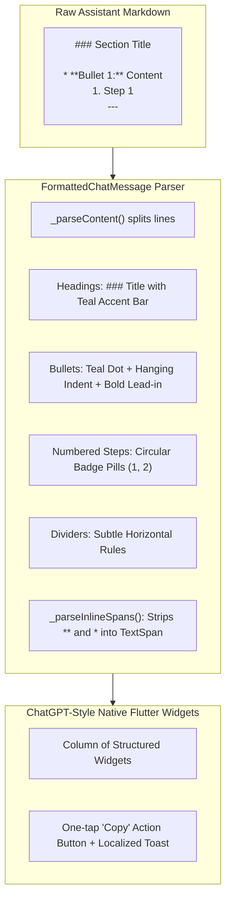

# Plan 03: Structured ChatGPT / Gemini-Style Response Formatting & Asterisk Elimination

## Goal Description
Upgrade the Yegna Health AI Assistant from displaying raw unformatted markdown text with visible asterisks (`**` and `*`) into structured, elegant visual elements matching ChatGPT and Google Gemini.

### Problems Solved
1. **Raw Markdown Artifacts**: `**Yegna Health**` and `* **Puberty and bodily hygiene:**` displayed literal asterisks rather than rich typography.
2. **Monolithic Text Blocks**: Multi-point answers formed dense walls of text that were hard for adolescents to scan on mobile screens.
3. **Missing List Hierarchy**: Lack of custom bullet indicators, numbered badges, and section dividers.

---

## Technical Architecture

---

## Key Components

### 1. `FormattedChatMessage` (`lib/src/chatbot/formatted_chat_message.dart`)
- Zero external dependencies; built entirely with native Flutter widgets (`Column`, `Row`, `Container`, `Text.rich`, `TextSpan`, `Divider`).
- **Heading Blocks (`###`)**: Primary brand dark navy text (`#08264A`) with vertical teal indicator bar (`#007A78`).
- **Bullet Items (`* `, `- `, `• `)**: Circular teal dot indicator with hanging indentation via `Row` + `Expanded`.
- **Numbered Steps (`1. `, `2. `)**: Soft numeric circular badges (`#E6F4F1` background, `#99D5CA` border).
- **Inline Styling**: Bold tokens (`**text**`) rendered with `FontWeight.w700` and dark slate tone (`#0F172A`), stripping asterisks completely. Italic tokens (`*text*`) rendered in italic style.
- **Copy Utility (`toPlainText`)**: Strips all markdown symbols into clean plain text for clipboard copying.

### 2. Chat UI Updates (`lib/src/chatbot/yegna_chatbot_page.dart`)
- Bubble width expanded to 88% on mobile (clamped 280–580px) for comfortable multi-point reading.
- Integrated one-tap "Copy" button (`Icons.copy_rounded`) at the bottom of assistant bubbles with localized snackbar (`Response copied to clipboard` / `ምላሹ ወደ ቅንጥብ ሰሌዳ ተቀድቷል`).

### 3. Remote Prompt Grounding (`supabase/functions/ask-assistant/index.ts`)
- Instructs Gemini to output structured markdown with clear headings, short paragraphs (2–3 sentences), and bold lead-in bullet points.

---

## Verification & Tests
- `test/formatted_chat_message_test.dart`: 7 unit/widget tests verifying headings, dividers, bullets, numbered lists, inline bold/italic, Amharic rendering, and plain-text clipboard stripping.
- 100% test pass rate across the full suite.
