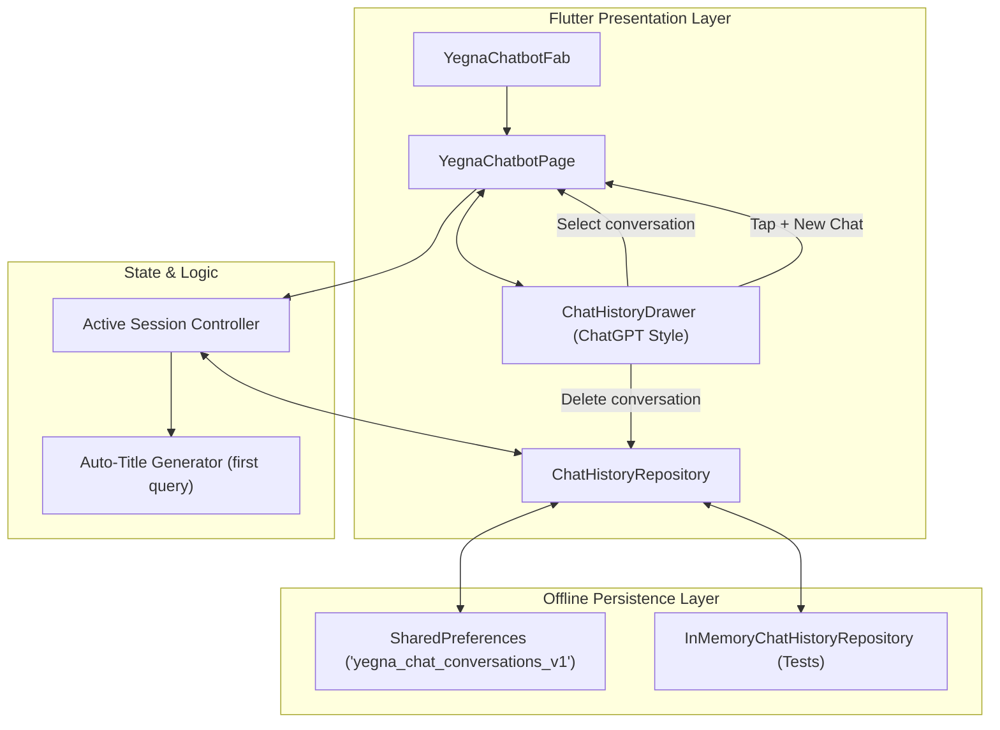

# Plan 04: ChatGPT-Style Multi-Session Chat History & Local Persistence

## Goal Description
Build an authentic, multi-session **Chat History** system for the Yegna Health Assistant, functioning like ChatGPT and Google Gemini. When users start a new conversation (`+ New Chat`), all past conversations are preserved, organized by date, easily browsable in a slide-out drawer, and resumable at any time.

---

## User Experience & Requirements
1. **Multi-Session Retention**: When a user creates a new chat, previous chat conversations are safely stored and listed in Chat History.
2. **`+ New Chat` Button**: Quick action in the AppBar and drawer header to start a fresh conversation with welcome prompts.
3. **Slide-Out Chat History Drawer**:
   - Organized into relative date sections: **Today**, **Yesterday**, **Previous 7 Days**, **Older**.
   - Each conversation item displays a chat icon, clean title (auto-generated from the first user query), preview snippet, and time.
   - Highlights the currently active conversation.
   - 1-tap delete button on each item with confirmation dialog.
   - "Clear all conversations" button in the drawer footer.
4. **Resuming Conversations**: Tapping any conversation in the history instantly loads its full thread into view and resumes it.
5. **100% Offline-First & Confidential**: Stored locally on-device via `SharedPreferences`. Personal chats are never exposed or synced without authorization.
6. **Bilingual Support**: Fully localized in English and Amharic ARB resources.

---

## Technical Architecture

---

## Component Breakdown

### 1. Data Models (`lib/src/chatbot/chatbot_models.dart`)
- `ChatMessage` & `EmergencyHotlineAction`: add `toJson()` and `fromJson()`.
- `ChatConversation`:
  - `id`: unique UUID/timestamp string.
  - `title`: auto-generated title (e.g. "What is HIV?", "Puberty symptoms").
  - `createdAt`: `DateTime`.
  - `updatedAt`: `DateTime`.
  - `messages`: `List<ChatMessage>`.
  - `previewText`: last message snippet.
  - `toJson()` & `fromJson()`.

### 2. Repository Layer (`lib/src/chatbot/chat_history_repository.dart`)
- `ChatHistoryRepository` interface:
  - `Future<List<ChatConversation>> loadConversations();`
  - `Future<void> saveConversation(ChatConversation conversation);`
  - `Future<void> deleteConversation(String conversationId);`
  - `Future<void> clearAll();`
- `SharedPreferencesChatHistoryRepository`:
  - Key: `yegna_chat_conversations_v1`.
  - Sorts conversations by `updatedAt` descending (newest first).
- `InMemoryChatHistoryRepository`:
  - Fast, zero-mock implementation for automated tests.

### 3. Drawer UI (`lib/src/chatbot/chat_history_drawer.dart`)
- Header with Yegna Health AI logo and `+ New Chat` button.
- Relative date grouping (Today, Yesterday, Previous 7 Days, Older).
- Conversation tile with title, message count, active highlight, and delete button.
- Empty state illustration ("No conversations yet").
- "Clear all conversations" footer button with safety confirmation.

### 4. Chat Page Integration (`lib/src/chatbot/yegna_chatbot_page.dart`)
- AppBar with hamburger drawer menu icon (`Icons.menu_rounded`) and `+ New Chat` button (`Icons.add_comment_outlined`).
- Auto-generate title upon sending first query in a session.
- Automatically persist message updates to `ChatHistoryRepository`.
- Switching conversations restores messages and updates active indicator.

---

## Verification Plan
- Unit tests for `ChatConversation` serialization and repository operations (`test/chat_history_repository_test.dart`).
- Widget tests for multi-session drawer navigation, `+ New Chat`, conversation switching, deletion, and Amharic localization (`test/chatbot_history_ui_test.dart`).
- Full test suite verification (100% pass rate).
